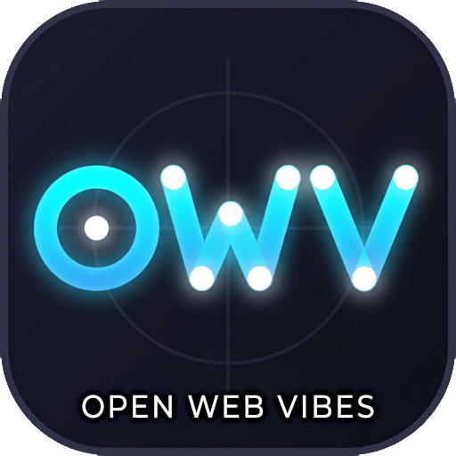
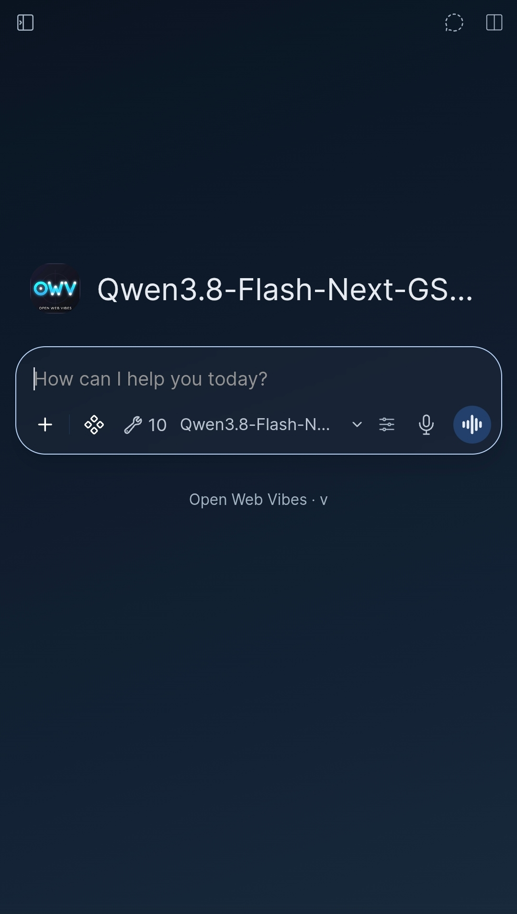
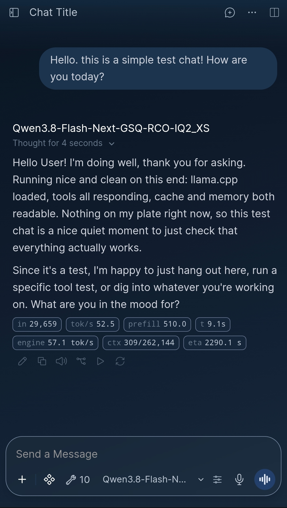
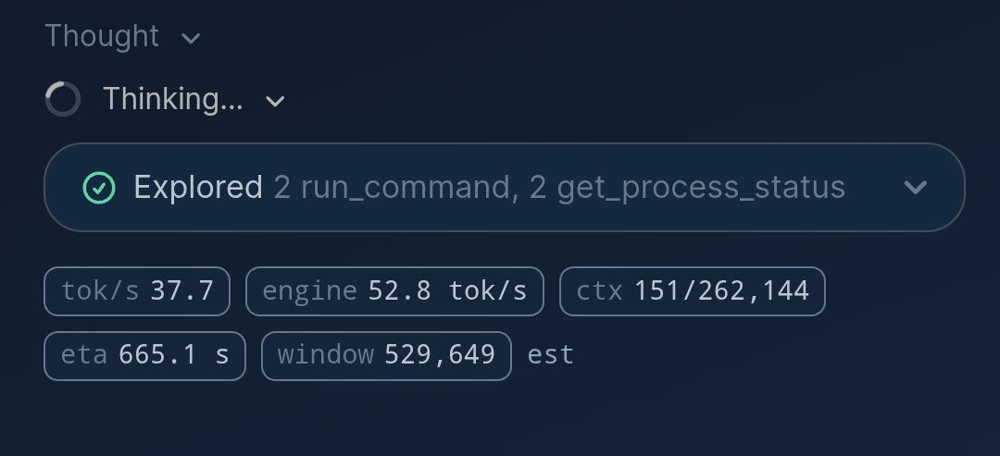
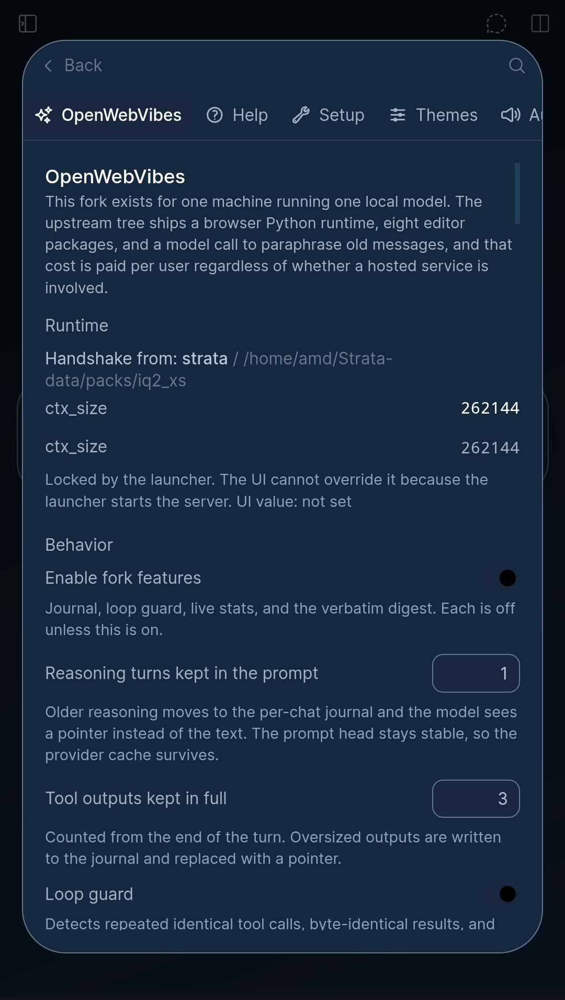
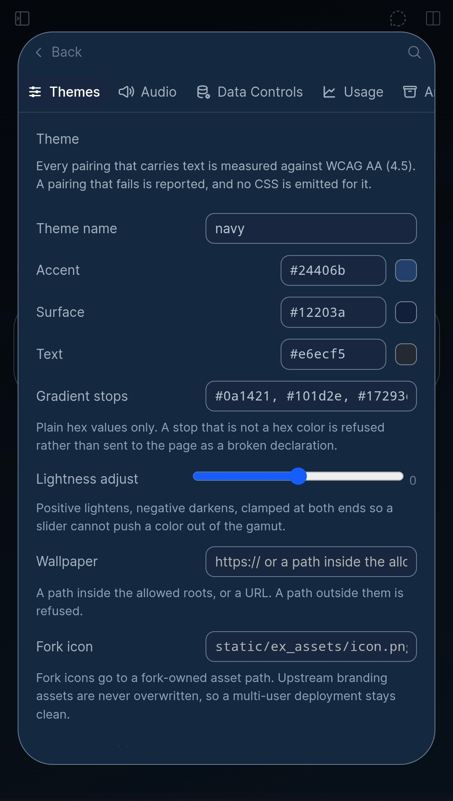
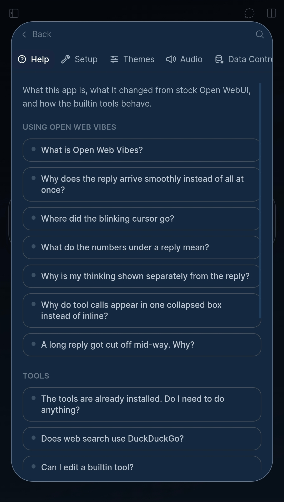

<h2>Open Web Vibes</h2>

<p align="center">
  
</p>

<p>A fork of <a href="https://docs.openwebui.com/"><strong>Open WebUI</strong></a> built for running huge
local models on one machine with an offline engine. The chat interface is the one you know. What this
fork exists to do is carry the parts upstream cannot or will not add: the context gate, the off-device
compute layer, support for every backend, and installing a backend from inside the app.</p>

[English](README.md) |
[简体中文](README.zh.md) |
[繁體中文](README.zht.md) |
[한국어](README.ko.md) |
[Deutsch](README.de.md) |
[Español](README.es.md) |
[Français](README.fr.md) |
[Italiano](README.it.md) |
[Dansk](README.da.md) |
[Türkçe](README.tr.md) |
[Русский](README.ru.md) |
[Polski](README.pl.md) |
[Nederlands](README.nl.md) |
[Filipino](README.fil.md) |
[Tiếng Việt](README.vi.md) |
[Português](README.pt.md) |
[فارسی](README.fa.md) |
[हिन्दी](README.hi.md)

<p align="center">
  <a href="https://github.com/open-webui/open-webui/blob/main/LICENSE"></a>
  <a href="https://www.gnu.org/licenses/gpl-3.0.html"></a>
</p>

## Screenshots

| Screen | What is in it |
| --- | --- |
|  | Home. Fork icon, model chip for Qwen3.8-Flash-Next-GSQ-RCO-IQ2_XS, tool count, the Open Web Vibes footer. |
|  | A turn with the stats row: `in 29,659`, `tok/s 52.5`, `prefill 510.0`, `t 9.1 s`, `engine 57.1 tok/s`, `ctx 309/262,144`, `eta 2290.1 s`. |
|  | A streaming turn. Engine rate and window fill against the engine's configured window, the message-list estimate kept as its own chip, tool activity in one collapsed panel. |
|  | Settings tab. Handshake values come from the launcher, so `ctx_size 262144` is read-only in the UI. Reasoning turns kept in the prompt, tool outputs kept in full, loop guard. |
|  | Theme engine. Every pairing that carries text is measured against WCAG AA, and a failing pairing emits no CSS. |
|  | Help tab, its own tab rather than a section at the bottom of the settings page. |

## What this fork is for

Upstream Open WebUI is a good front end for a local model that fits in memory. This fork is about the
things that stop working once the model is bigger than the machine and the chat is longer than the
window, and about the features a single machine fork needs that a multi-user web app will not take on.

**What is here now**

- **The context gate.** The request is measured after tool results are materialized, so the number
  matches what the engine bills. The rollover point fires instead of the prompt growing until the
  engine answers 400. Evicted text goes to disk verbatim plus an addressable index, and to the vector
  store, so it is still findable by meaning.
- **One machine, one model.** No browser Python runtime, no eight editor packages, no model call to
  paraphrase old messages, and no feature meter paid per user.
- **Nine builtin tools, enabled on first launch**, editable without an update overwriting the edit.
- **Honest stats.** `in` reports the current request, not a running total; prefill is kept apart from
  the turn count; the window fill chip names where its number came from.

**What this fork exists to add**

- **Off-device cluster.** Other devices as workers: the laptop is the master, a phone is a memory and
  compute pool the master draws on, reached over ggml-rpc on the LAN only. `ex_cluster.py` is the pure
  planning layer; the transport is not wired yet.
- **Support for all backends, and backend install from inside the app.** The choice is per model: a
  GGUF is a llama.cpp candidate, a prepared pack is a Strata candidate. The app records the choice and
  writes an install plan the launcher executes; it never boots a server by itself. `ex_backend.py` and
  `ex_discover.py`.
- **MCP is already upstream**, so what is left here is the part upstream cannot do on one machine:
  tool results counted against the window and sheddable at the rollover point, so a tool-heavy chat
  does not die at the engine limit.
- **Crash-surviving turns** with a throttled write policy, so a turn is not lost when the process dies,
  and so a buffer does not write on every arrival.

**Why any of this is possible on a laptop**

Strata. Qwen3.8-Flash-Next-GSQ-RCO-IQ2_XS and DeepSeek Flash Next are mixture-of-experts models whose
routed expert set is larger than local VRAM. Strata keeps the shared expert resident and pulls the
routed experts over PCIe, which is what makes a model of that size answer at a usable rate on this box.
The runs that produced these screenshots say it plainly: 262,144 context, engine rates around 50 to 57
tok/s, and an expert cache hitting 82.7% with 11.8% of the routed experts fetched over PCIe. This fork
running that model on this machine, with a 262k window held open by the gate instead of compaction, is
the proof it can be done.

## Open Web Vibes

This is **Open Web Vibes**, a fork of Open WebUI built for running local models on your own
hardware. The chat interface is the one you know. What changed is how the app talks to its
inference engine, how it presents a turn, and what ships with it.

Upstream licence and notices are unchanged. Open WebUI remains the project this is built on.

### Nine tools are built in

You do not install these. They ship with the app and are **enabled by default**, so they work on
first launch. Each can be switched off individually under **Settings → OpenWebVibes → Builtin
tools**.

| Tool | What it does |
| --- | --- |
| **Web Search** | Fetches pages and keeps them on disk, so a follow-up question about the same page does not refetch it. Can slice or search a page instead of pulling it in whole, and does multi-source research. |
| **Reddit + X Reader** | Reads posts, threads, timelines and profiles from Reddit and X. |
| **YouTube Video Parser** | Reads a video's transcript. |
| **YouTube Visual Reader** | Describes what is on screen, with timestamps. |
| **Reverse Engineering** | Helpers for inspecting binaries: triage, decompilation, disassembly, string and symbol search. |
| **Fleet Ops** | Operates a fleet of machines: discovery, sessions, persistent shells. |
| **Fleet SSH + RustDesk** | Runs commands over SSH, transfers files, manages a credential vault and remote sessions. |
| **Calculator** | Expression evaluation and equation solving. |
| **Cognitive Memory Vault** | Indexes and searches your own saved context. |

**Two of these reach beyond the local machine.** Fleet Ops and Fleet SSH can run commands on
remote hosts over SSH and read credentials from a local vault. They are inert on a machine with no
vault, but if you do not run a fleet, that is the pair to switch off first.

### Web search is replaced, not added

Stock Open WebUI bundled a DuckDuckGo-backed search. Here it is **replaced**. There is one search
tool and no ambiguity about which one ran. It is cache-first: a page is fetched once, then read
from disk, which makes follow-up questions cheap and keeps a long document from filling the
context window.

### Edits survive updates

Any builtin can be edited, and your edit is stored **separately from the tool**. It is used
instead of the built-in one, and an app update does not overwrite it. If the shipped tool changes
after you edited it, the row is marked so you can see that your edit is hiding a newer version.
There is a one-click revert.

### Other things worth knowing

- **Reasoning is kept next to the answer.** Thinking renders as its own collapsible line, in
  place, rather than being bundled in with tool activity.
- **Tool calls are collected, not inline.** A turn's tool activity goes into one collapsible panel
  at the end of the reply, so the reply body stays continuous prose. Individual calls are still
  expandable inside it.
- **Stats are honest about prompt size.** `in` reports the current request, not a running total.
  Every round of a multi-step turn re-sends the whole conversation, so adding prompt counts
  together would double-count the same context.
- **Streaming is paced**, so a backend that sends text in bursts still reads smoothly.
- **The blinking cursor is gone.** With a chunked engine it drew attention to the pauses rather
  than the words.
- **One Connections tab.** There were two, one showing only the connections set per user and one
  showing the whole stored list with the model paths. The per-user one is gone; the full list is
  what remains.

### Backup and restore

One button, as-is copy, nothing rebuilt. `backup-owv` mirrors the whole install to the NAS and
`sync-owv` mirrors it back, same shape as the stock `backup-oui` and `sync-oui` aliases: `rsync`, no
archive, no database rebuild, no cache clearing, nothing deleted, so a restore is a copy and not a
reinstall. The stock Open WebUI aliases are untouched.

The set is the fork tree, the dev tree, the data dir, the runtime data and state, the launchers, and the
terminal api key file. The first run is about 12.6 GB and most of that is regenerable material: 7.3 GB
of venv and 1.7 GB of node_modules. After the first run only deltas move. If you want the backup small,
add `--lean` to skip venv, node_modules, .svelte-kit, build and .git, which brings it to about 1.9 GB,
and a restore on a new machine then needs `uv sync` and `npm install`.

### Help inside the app

**Settings → Help** answers the questions these changes raise, including where things are stored
and how to back up an install. It is its own tab now rather than a section inside the OpenWebVibes
tab, because the questions it answers are not about the vibes settings specifically, and a search
for "help" lands on a tab rather than on a page you have to scroll to the bottom of.

### Reporting something

Open an issue with what you did, what you expected, and what happened. If a tool failed, its row
under Builtin tools shows the exception; that text is the most useful thing to include.

### Installation

#### Python

Requires Python 3.12.

```bash
pip install open-webui
open-webui serve
```

Then open [http://localhost:8080](http://localhost:8080).

#### Docker

```bash
docker run -d -p 3000:8080 --add-host=host.docker.internal:host-gateway -v open-webui:/app/backend/data --name open-webui --restart always ghcr.io/open-webui/open-webui:main
```

Then open [http://localhost:3000](http://localhost:3000).

| Image tag | Includes                                                                                 |
| --------- | ---------------------------------------------------------------------------------------- |
| `:main`   | Standard image with local AI dependencies                                                |
| `:slim`   | Lightweight image using external services for embeddings, document extraction, and voice |
| `:cuda`   | Open WebUI with CUDA acceleration                                                        |
| `:ollama` | Open WebUI bundled with Ollama                                                           |
| `:dev`    | Latest development build                                                                 |

Add these options to `docker run` before the image name as needed:

| Option                                               | Purpose                                                                                  |
| ---------------------------------------------------- | ---------------------------------------------------------------------------------------- |
| `-e OLLAMA_BASE_URL=http://your-ollama-server:11434` | Connect to Ollama on another server                                                      |
| `-e OPENAI_API_KEY=your_secret_key`                  | Set your OpenAI API key                                                                  |
| `-e HF_HUB_OFFLINE=1`                                | Disable Hugging Face model downloads for offline use                                     |
| `--gpus all`                                         | Enable Nvidia GPU access for `:cuda` or `:ollama`; requires the Nvidia Container Toolkit |

See the [Docker installation guide](https://docs.openwebui.com/getting-started/quick-start/) for setup instructions and configuration options.

#### Desktop App

[Download the native desktop app](https://github.com/open-webui/desktop) for macOS, Windows, and Linux.

[Read the docs →](https://docs.openwebui.com/getting-started/)

### Ecosystem

- [Open Terminal](https://github.com/open-webui/open-terminal) / [Terminals (Enterprise)](https://github.com/open-webui/terminals): The action layer that turns Open WebUI into a full agent harness, with enterprise orchestration for per-user workspaces.
- [Knowledge Base Sync (oikb)](https://github.com/open-webui/oikb): Mirror folders, repos, buckets, and wikis into Open WebUI Knowledge Bases with incremental sync.
- [Open WebUI Computer](https://github.com/open-webui/computer): Your computer in any browser: files, editor, terminal, git, and optional AI agents, running on your real machine.

See the [ecosystem documentation](https://docs.openwebui.com/ecosystem/) for details.

### Troubleshooting and Updates

See the [troubleshooting guide](https://docs.openwebui.com/troubleshooting/) for connection issues and the [updating guide](https://docs.openwebui.com/getting-started/updating) to update your installation.

### Documentation

See the [docs](https://docs.openwebui.com/) for configuration and usage, and the [roadmap](https://docs.openwebui.com/roadmap/) for planned work.

For Docker Compose, Kubernetes, and other setups, see the [installation docs](https://docs.openwebui.com/getting-started/).

### Support

[Open an issue](https://github.com/open-webui/open-webui/issues) or [start a discussion](https://github.com/open-webui/open-webui/discussions).

Find us on [Reddit](https://www.reddit.com/r/OpenWebUI/), [X](https://x.com/OpenWebUI), and [Discord](https://discord.gg/5rJgQTnV4s).

### Security

Report vulnerabilities privately through [GitHub security advisories](https://github.com/open-webui/open-webui/security). Security reports are accepted only through GitHub.

### Star History

<a href="https://star-history.com/#open-webui/open-webui&Date">
  <picture>
    <source media="(prefers-color-scheme: dark)" srcset="https://api.star-history.com/svg?repos=open-webui/open-webui&type=Date&theme=dark" />
    <source media="(prefers-color-scheme: light)" srcset="https://api.star-history.com/svg?repos=open-webui/open-webui&type=Date" />
    
  </picture>
</a>

#### License

Includes code under the Open WebUI License, which requires preserving the Open WebUI branding, and prior contributions under their original licenses. See [LICENSE](./LICENSE) and [LICENSE_HISTORY](./LICENSE_HISTORY) for terms and history.

[Enterprise](https://docs.openwebui.com/enterprise) · [Careers](https://careers.openwebui.com/) · [Sponsor](https://github.com/sponsors/open-webui)

Created by [Timothy Jaeryang Baek](https://github.com/tjbck).
